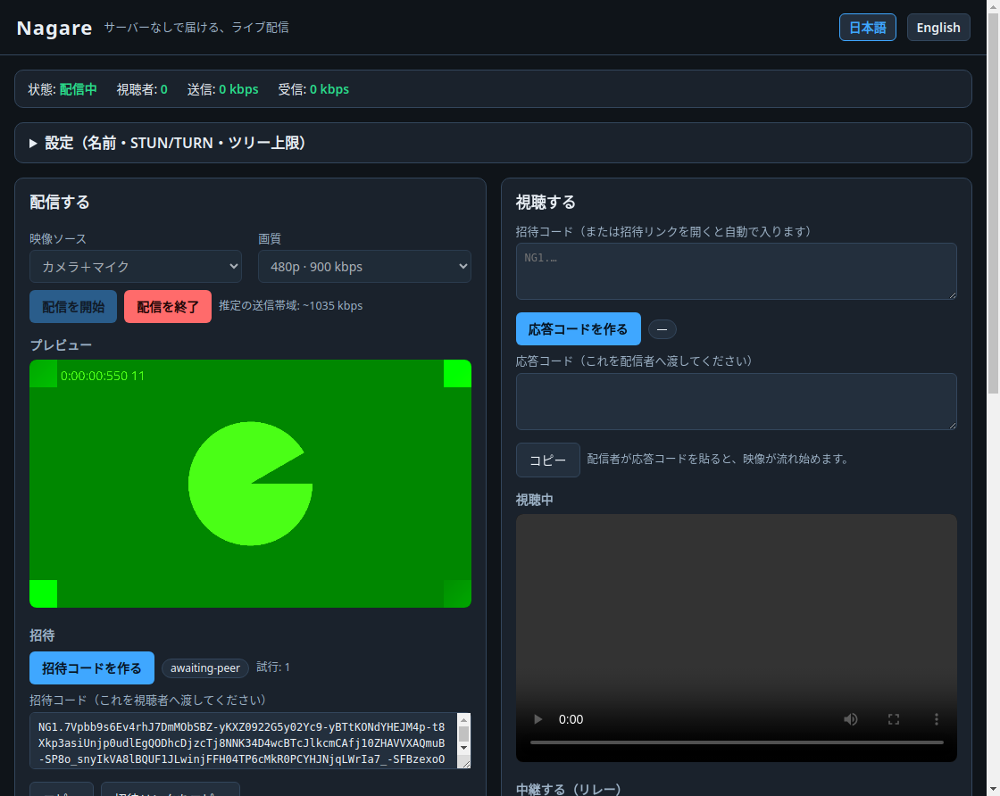
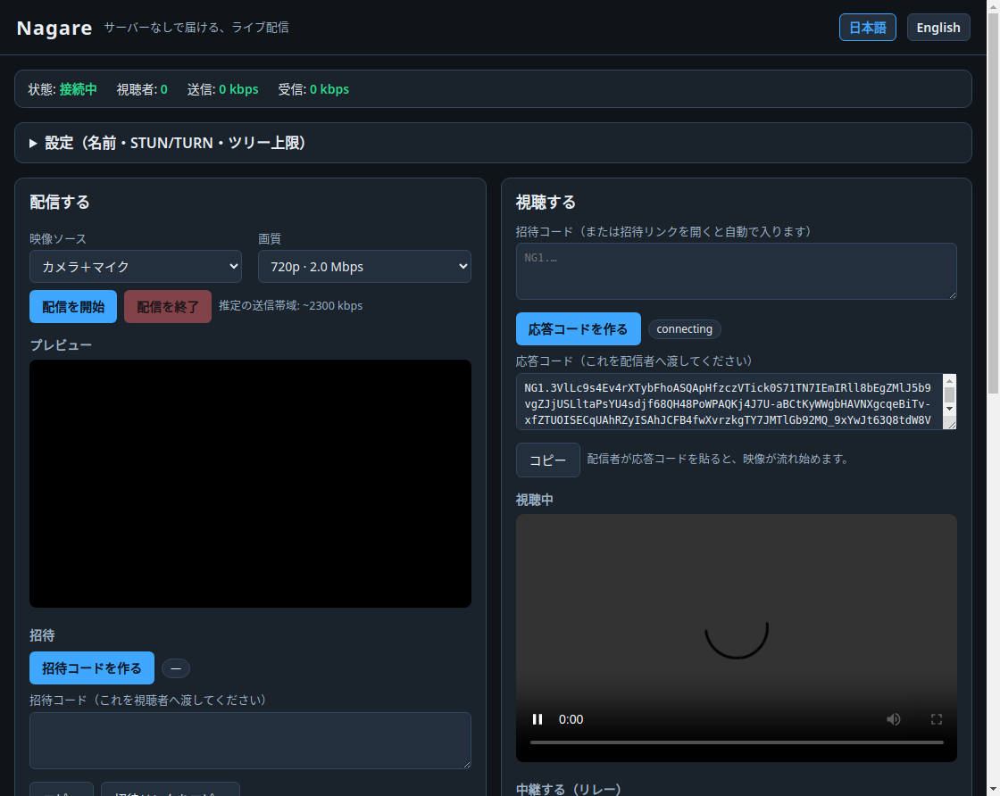

# Nagare — サーバーレス P2P ライブ配信

**中央サーバーを一切持たないライブ配信アプリです。** 配信者と視聴者のブラウザが
WebRTC で直接つながり、視聴者が中継者（リレー）になることで視聴者を増やします。
運用者（作成者）が運営するサーバーは存在しません。アプリは単一の HTML ファイル
（`nagare.html`）で、外部依存はゼロです。ダウンロードしてブラウザで開くだけで
使えます（静的ホスティングに置いても構いません）。

**正規の配布形態はデスクトップアプリ（ソフトウェア）です。** 同じ `nagare.html`
を Electron の殻で包んだもので、[Releases](https://github.com/shizukutanaka/Nagare/releases)
から入手できます（Windows=portable `.exe`／macOS=`.zip`／Linux=`.AppImage`）。
単一 HTML 版も引き続き同梱しますが、デスクトップ版を基準とします。




## 仕組み

1. **配信者**がカメラ／画面共有／マイクで配信を開始し、「招待コード」を発行します。
2. **視聴者**は招待コードを貼り、「応答コード」を発行して配信者へ返します。
3. 配信者が応答コードを貼ると接続が成立し、映像が流れます。
4. 視聴者は受信中の映像をそのまま再配信（**リレー**）して新しい招待を発行でき、
   配信ツリーが育ちます。既定では1人あたり最大3人へ中継、最大4段まで
   （理論上の最大視聴者は120人）。

接続に必要な情報（SDP＋ICE候補）は圧縮してコード化され、利用者同士が直接
交換します。招待リンク（`nagare.html#i=…`）のフラグメントはサーバーへ送信
されません。チャットと視聴者数の共有は DataChannel で行われます。

設計の詳細と判断根拠は [docs/DESIGN.md](docs/DESIGN.md) にあります。

## 使い方

### 配信する

1. `nagare.html` をブラウザで開く。
2. ソース（カメラ／画面／マイクのみ）と画質を選び、「配信を開始」。
3. 「招待コードを作る」を押し、コード（または招待リンク）を視聴者へ渡す。
4. 視聴者から受け取った「応答コード」を貼り、「接続する」。

### 視聴する

1. 招待コードを貼る（招待リンクを開いた場合は自動で入っています）。
2. 「応答コードを作る」を押し、応答コードを配信者へ渡す。
3. 配信者が貼ると映像が流れます。

### 中継する

視聴中に「中継する（リレー）」の「招待コードを作る」から新しい視聴者を招けます。
あなたがタブを閉じると、あなた経由の視聴者は切断されます。

## 正直な限界

- **ルームの自動発見はありません。** 配信を知る手段はコードやリンクの交換だけです。
- **接続できない NAT の組み合わせがあります。** 双方が対称型 NAT の奥にいる場合
  などは TURN が必要です（Nagare は TURN を用意しません。自分の TURN を設定欄に
  入力できます。使うと映像はその TURN を経由します）。
- **招待コードは「鍵」です。** 持っている人は誰でも参加できます。コードには
  あなたの IP アドレス候補が含まれます。見せてよい相手にだけ渡してください。
- リレーは段数ぶん遅延が増え、中継者の回線が細いと配下全員の画質が落ちます。
- チャットは中継者が転送時に読めます（中継の仕組み上避けられません）。

## 設定

- STUN サーバー（既定値あり、変更可能）
- TURN（任意。URL・ユーザー名・パスワード。端末内にのみ保存）
- ツリー上限（1人あたりの中継数 1〜6、中継段数 1〜8）
- 表示名、UI 言語（日本語／英語）

## デスクトップ版

- 殻（`desktop/main.js`）は `nagare.html` をそのまま読み込むだけで、アプリ本体には
  手を加えていません。contextIsolation 有効／nodeIntegration 無効／sandbox 有効／
  preload なしで動きます。
- 新しいウィンドウと `nagare.html` 以外への遷移は遮断します。http／https のリンクは
  OS の既定ブラウザで開きます。
- 権限はメディア関連（カメラ／マイク／画面共有）のみ許可し、それ以外（位置情報・
  通知など）は拒否します。
- デスクトップ版では招待リンクがローカルファイルのパスになるため、相手には
  招待コードを渡してください。
- **未署名です。** Windows では SmartScreen（「Windows によって PC が保護されました」
  →「詳細情報」→「実行」）、macOS では Gatekeeper（右クリック→「開く」、または
  「システム設定 > プライバシーとセキュリティ」から許可）の警告が出ることがあります。

```sh
npm ci            # electron / electron-builder は版数固定（package-lock 同梱）
npm start         # 殻を起動
npm run dist:win  # または dist:mac / dist:linux（出力先 dist-desktop/）
```

## 開発とテスト

```sh
# 単体テスト（Node 20+、依存なし）: コーデック往復、状態遷移、ツリー上限、プロトコル検証
npm test

# 実接続テスト（Electron が必要）: 配信→視聴→リレーの実フロー、映像とチャットの往復
NAGARE_ELECTRON=/path/to/electron npm run test:e2e
```

実接続テストは、配信・視聴・リレーの3画面を Electron で開き、フェイクカメラで
映像を作り、コード交換を自動で行って、映像が流れることとチャットの往復、
視聴者数の集計を確認します。チェックは `[app]`（アプリの責任範囲）と
`[transport]`（ペア間の UDP 到達性が必要）に分かれて表示されます。UDP 送信が
ポリシーで禁止されたサンドボックス環境では `[transport]` は失敗しますが、
それは環境の制約であり、通常のマシンや CI では全て通過します。

---

## English summary

Nagare is serverless P2P live streaming in a single HTML file with zero
dependencies. The operator runs no server: broadcasters and viewers connect
directly over WebRTC, and signaling (SDP + ICE candidates) is compressed into
codes that people exchange themselves — or into invite links whose fragment is
never sent to any server. Viewers can relay the stream to new viewers, forming
a distribution tree (default: up to 3 children per node, 4 levels deep, ~120
viewers max). Chat and viewer counts travel over DataChannels. STUN is
configurable; TURN is bring-your-own. There is no room discovery, some NAT
combinations cannot connect without TURN, and an invite code is a bearer key
that reveals your IP address candidates — all documented honestly in
[docs/DESIGN.md](docs/DESIGN.md).

## License

MIT
